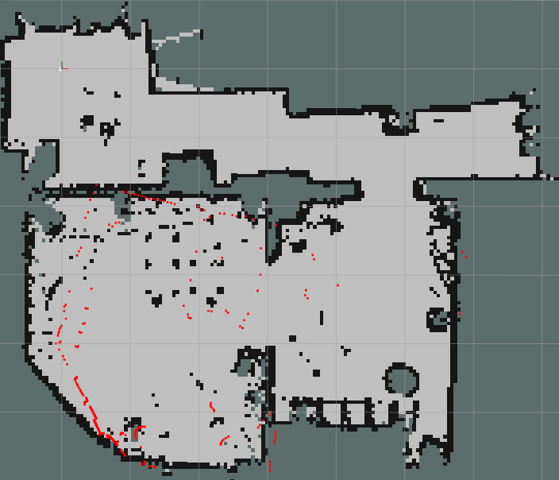
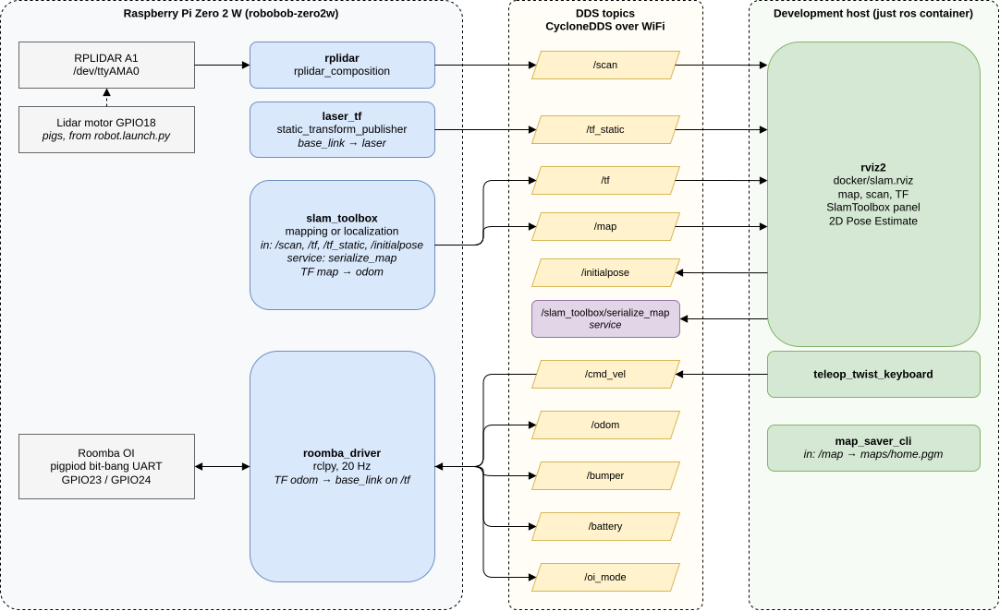

# Roomba SLAM

RoboBob SLAM turns a Roomba 600-series vacuum into a SLAM robot. A Raspberry Pi Zero 2 W reads an RPLIDAR A1 and drives the Roomba over its Open Interface (OI), running ROS2 Jazzy on a Yocto-built image. A development host on the same WiFi runs RViz and teleop.



## Hardware

- **Robot base:** iRobot Roomba 600 (Create 2 OI compatible)
- **Compute:** Raspberry Pi Zero 2 W (Cortex-A53 quad-core, 512 MB RAM)
- **Lidar:** SLAMTEC RPLIDAR A1M8, 360°, 12 m range, on the Pi's UART

Wiring, pinouts and power are in [docs/hardware.md](docs/hardware.md).

## Status

| Phase | What | Status |
|-------|------|--------|
| 1 | Base image: SSH, pigpiod, chrony, self-tests | Done |
| 2 | ROS2 Jazzy, CycloneDDS | Done |
| 3 | Drivers: rplidar_ros, roomba_driver | Done |
| 4 | SLAM and localization with slam_toolbox on the Pi | Done |
| 5 | Navigation with nav2 | Next |

## Architecture



## Quick start

Only Docker and [just](https://github.com/casey/just) are needed on the host.

1. Build and flash the image: `just build-ros`, `just flash /dev/sdX` ([yocto](yocto/README.md))
2. Check the wiring on the Pi: `lidar-selftest`, `roomba-selftest` ([lidar](yocto/meta-robobob/recipes-lidar/lidar-selftest/README.md), [roomba](yocto/meta-robobob/recipes-roomba/roomba-selftest/README.md))
3. Bring up the robot: `ros2 launch slam_bringup robot.launch.py` ([slam_bringup](ros/src/slam_bringup/README.md))
4. Drive it from the host: `just ros ros2 run teleop_twist_keyboard teleop_twist_keyboard` ([docker](docker/README.md))
5. Map: `ros2 launch slam_bringup slam.launch.py` on the Pi, `just rviz` on the host ([slam_bringup](ros/src/slam_bringup/README.md#slam))

## Docs

| Doc | Covers |
|-----|--------|
| [docs/hardware.md](docs/hardware.md) | Wiring, pin map, level shifter, OI connector, lidar mount |
| [docs/ros-architecture.drawio.svg](docs/ros-architecture.drawio.svg) | ROS nodes, topics and TF on the Pi and the host |
| [docs/wiring.drawio.svg](docs/wiring.drawio.svg) | Pi, level shifter, lidar and Roomba connections |
| [yocto/README.md](yocto/README.md) | Building and flashing the image, WiFi, layers |
| [lidar-selftest](yocto/meta-robobob/recipes-lidar/lidar-selftest/README.md) | RPLIDAR check without ROS |
| [roomba-selftest](yocto/meta-robobob/recipes-roomba/roomba-selftest/README.md) | Roomba OI check without ROS |
| [roomba_driver](ros/src/roomba_driver/README.md) | OI node: topics, parameters, calibration |
| [slam_bringup](ros/src/slam_bringup/README.md) | Robot bring-up, SLAM, localization |
| [docker/README.md](docker/README.md) | Host side: ROS container, RViz, teleop |

## References

| Topic | Links |
|-------|-------|
| Roomba | [Create 2 / Roomba 600 OI spec (PDF)](https://cdn.hackaday.io/files/1835247851890816/2021-04-13_iRobot_Roomba_600_Open_Interface_Spec-3.pdf) |
| Lidar | [RPLIDAR A1 specs](https://www.slamtec.com/en/Lidar/A1Spec), [rplidar_sdk](https://github.com/slamtec/rplidar_sdk), [rplidar_ros](https://github.com/Slamtec/rplidar_ros/tree/ros2) |
| Pi | [pigpio](https://abyz.me.uk/rpi/pigpio/), [TXS0108E datasheet (PDF)](https://www.ti.com/lit/ds/symlink/txs0108e.pdf) |
| ROS2 | [Jazzy docs](https://docs.ros.org/en/jazzy/), [tf2](https://docs.ros.org/en/jazzy/Tutorials/Intermediate/Tf2/Tf2-Main.html), [REP 105 frames](https://www.ros.org/reps/rep-0105.html), [CycloneDDS](https://docs.ros.org/en/jazzy/Installation/RMW-Implementations/DDS-Implementations/Working-with-Eclipse-CycloneDDS.html) |
| SLAM and navigation | [slam_toolbox](https://github.com/SteveMacenski/slam_toolbox), [Nav2](https://docs.nav2.org/) |
| Build | [Yocto docs](https://docs.yoctoproject.org/), [kas](https://kas.readthedocs.io/), [meta-ros](https://github.com/ros/meta-ros), [meta-raspberrypi](https://github.com/agherzan/meta-raspberrypi), [just](https://github.com/casey/just) |

## Repository Layout

```
justfile        # build, flash, ros, rviz, push
docs/           # hardware notes
docker/         # ROS2 Jazzy container for the host
yocto/          # Yocto build: kas configs and the meta-robobob layer
ros/src/        # ROS2 packages: roomba_driver, slam_bringup
```
