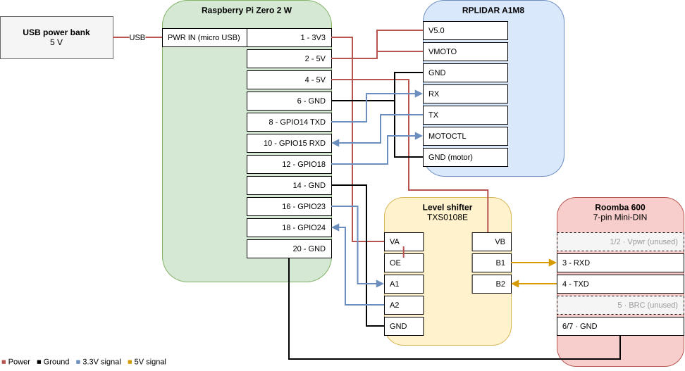

# Hardware

## Pin map

| Signal | Pi pin | Notes |
|--------|--------|-------|
| Lidar RX | GPIO14 (TXD) | PL011 → `/dev/ttyAMA0`, 115200 8N1 |
| Lidar TX | GPIO15 (RXD) | |
| Lidar MOTOCTL | GPIO18 | High = motor on |
| Roomba RXD (Mini-DIN pin 3) | GPIO23 | pigpio bit-bang TX, through the level shifter |
| Roomba TXD (Mini-DIN pin 4) | GPIO24 | pigpio bit-bang RX, through the level shifter |
| Roomba GND (Mini-DIN pin 6/7) | GND | |

The Pi Zero 2 W has one usable hardware UART. `dtoverlay=disable-bt` frees the PL011 from Bluetooth and gives it to the lidar, which needs the throughput. The Roomba runs on a software UART at 19200 baud through `pigpiod`.

## Roomba Open Interface

7-pin Mini-DIN on the rear right of the Roomba.

| Pin | Signal | Notes |
|-----|--------|-------|
| 1, 2 | Vpwr | Unregulated battery, fused 200 mA continuous. Do not power the Pi from here |
| 3 | RXD | Into the Roomba, 0–5 V |
| 4 | TXD | Out of the Roomba, 0–5 V |
| 5 | BRC | Not wired |
| 6, 7 | GND | |

The Roomba uses 5 V logic and the Pi 3.3 V, so RXD and TXD go through a bidirectional level shifter (TXS0108E style). Tie its OE pin to 3.3 V, or every channel floats.

The OI boots at 115200 baud, too fast for a bit-bang UART. Software switches it to 19200 once after power-up. BRC is not wired, so a sleeping Roomba can't be woken over serial: press CLEAN once.

Always leave the OI in Passive before disconnecting. Safe or Full mode blocks charging and will deep-discharge the battery.

## Lidar

- 5 V logic and motor supply. 5.5 Hz scans by default; 10 Hz needs 9 V on the motor.
- No USB adapter, so no DTR line: the motor is switched on GPIO18 by the launch file.
- Mounted centred over the wheel axle, facing backwards. The launch file's default `laser_yaw` of π matches this.

## References

- [Create 2 / Roomba 600 Open Interface spec (PDF)](https://cdn.hackaday.io/files/1835247851890816/2021-04-13_iRobot_Roomba_600_Open_Interface_Spec-3.pdf), also on [iRobot's education site](https://edu.irobot.com/learning-library/create-2-oi-spec)
- [RPLIDAR A1 specifications](https://www.slamtec.com/en/Lidar/A1Spec) and [rplidar_sdk](https://github.com/slamtec/rplidar_sdk), which implements the serial protocol
- [TXS0108E level shifter datasheet (PDF)](https://www.ti.com/lit/ds/symlink/txs0108e.pdf)
- [pigpio](https://abyz.me.uk/rpi/pigpio/), used for the software UART
