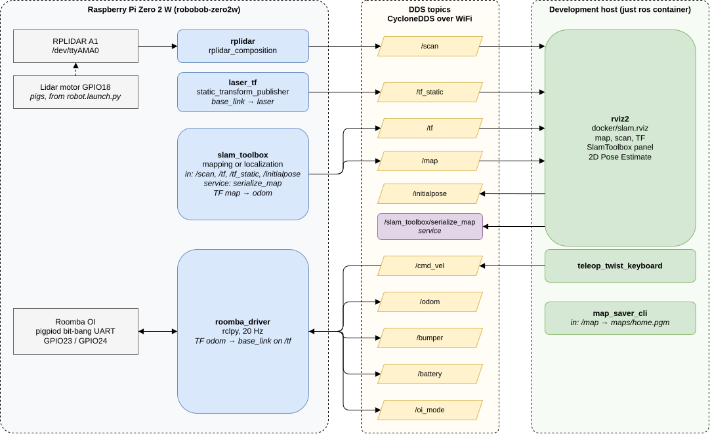

# slam_bringup

Launch files and parameters for the robot. Everything here runs on the Pi; the host side is in [docker](../../../docker/README.md).

| File | Purpose |
|------|---------|
| `launch/robot.launch.py` | Lidar, Roomba driver, `base_link → laser` TF |
| `launch/slam.launch.py` | The above plus slam_toolbox, mapping or localization |
| `config/rplidar.yaml` | rplidar_ros parameters |
| `config/roomba.yaml` | [roomba_driver](../roomba_driver/README.md) parameters |
| `config/slam.yaml` | slam_toolbox parameters |

## Robot bring-up

```bash
# on the Pi, with the Roomba awake and off the dock
ros2 launch slam_bringup robot.launch.py
```

The lidar motor on GPIO18 is switched on at launch and off at shutdown, since `rplidar_ros` expects a DTR line the Pi UART doesn't have. `/scan` comes out at about 7 Hz in frame `laser`.

The lidar is mounted over the wheel axle facing backwards, so `laser_yaw` defaults to π. Override the mount with `laser_x`, `laser_y`, `laser_z` and `laser_yaw`:

```bash
ros2 launch slam_bringup robot.launch.py laser_x:=0.05 laser_yaw:=0.0
```

To check it, open RViz with fixed frame `base_link` and put something in front of the robot: the points should appear along the red x axis.

## SLAM

```bash
# on the Pi
ros2 launch slam_bringup slam.launch.py

# on the host
just rviz
just ros ros2 run teleop_twist_keyboard teleop_twist_keyboard
```

Drive around slowly. The map grows in RViz as the scans come in. Mapping a room uses about 100 MB of RAM on the Pi.

Save the map as an image on the host, while SLAM is running:

```bash
just ros "mkdir -p maps && ros2 run nav2_map_server map_saver_cli -f maps/home --ros-args -p map_subscribe_transient_local:=true"
```

The Save Map button in the RViz panel does not work, since `map_saver_cli` is not on the Pi.

## Localization

slam_toolbox localizes against its own pose graph, not the image. Save it on the Pi while mapping:

```bash
just ros 'ros2 service call /slam_toolbox/serialize_map slam_toolbox/srv/SerializePoseGraph "{filename: /home/root/maps/home}"'
```

Then start later runs from it:

```bash
# on the Pi
ros2 launch slam_bringup slam.launch.py map:=/home/root/maps/home
```

The robot must start where the map was started, or set its pose with 2D Pose Estimate in RViz. Maps on the Pi are lost when the SD card is reflashed.

## Topics

The topics a full `slam.launch.py` run uses. The diagram shows how they connect.



| Topic | Type | From → to | Description |
|-------|------|-----------|-------------|
| `/scan` | `sensor_msgs/LaserScan` | rplidar → slam_toolbox, rviz2 | Lidar sweep in frame `laser`, about 7 Hz |
| `/tf` | `tf2_msgs/TFMessage` | roomba_driver, slam_toolbox → all | `odom → base_link` from wheel odometry and `map → odom` from SLAM, both 20 Hz |
| `/tf_static` | `tf2_msgs/TFMessage` | laser_tf → all | `base_link → laser`, the lidar mount. Latched |
| `/map` | `nav_msgs/OccupancyGrid` | slam_toolbox → rviz2, map_saver_cli | Occupancy grid at 5 cm, updated every 5 s. Latched |
| `/initialpose` | `geometry_msgs/PoseWithCovarianceStamped` | rviz2 → slam_toolbox | 2D Pose Estimate, sets the robot's pose in localization mode |
| `/cmd_vel` | `geometry_msgs/Twist` | teleop → roomba_driver | Velocity command; wheels stop 0.5 s after the last one |
| `/odom` | `nav_msgs/Odometry` | roomba_driver | Wheel odometry pose and velocity, 20 Hz |
| `/bumper` | `std_msgs/UInt8` | roomba_driver | Bump and wheel-drop bits |
| `/battery` | `sensor_msgs/BatteryState` | roomba_driver | Voltage, current, charge, 1 Hz |
| `/oi_mode` | `std_msgs/String` | roomba_driver | OI mode (`off`, `passive`, `safe`, `full`). Latched |

| Service | Type | Description |
|---------|------|-------------|
| `/slam_toolbox/serialize_map` | `slam_toolbox/srv/SerializePoseGraph` | Saves the pose graph on the Pi, for localization |

More detail on the driver's topics is in [roomba_driver](../roomba_driver/README.md#topics).

## Editing on the robot

`just push` copies the `roomba_driver` sources and the `slam_bringup` launch and config files to the Pi, so no image rebuild is needed. Set `ROBOT=<ip>` if `robobob-zero2w.local` doesn't resolve.

## References

- [slam_toolbox](https://github.com/SteveMacenski/slam_toolbox): modes, parameters and services
- [rplidar_ros](https://github.com/Slamtec/rplidar_ros/tree/ros2)
- [ROS2 launch files](https://docs.ros.org/en/jazzy/Tutorials/Intermediate/Launch/Launch-Main.html)
- [tf2](https://docs.ros.org/en/jazzy/Tutorials/Intermediate/Tf2/Tf2-Main.html) and [REP 105](https://www.ros.org/reps/rep-0105.html)
- [Nav2](https://docs.nav2.org/), the next step
